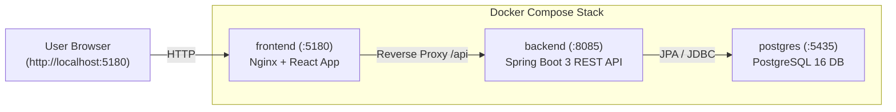

# EventSpot — Artist Event Hosting & Admin Moderation Platform

A full-stack, enterprise-grade event hosting and moderation system built with **Spring Boot 3 (Java 17+)**, **PostgreSQL 16**, and **React (Vite + React Router)**.

---

## 🚀 One-Command Docker Run (All Services Together)

Everything (**PostgreSQL Database + Spring Boot Backend + React Frontend**) is containerized and orchestrated together on collision-free dedicated ports:

To start the entire application stack:
```bash
docker compose up --build
```
*(Or in background mode: `docker compose up --build -d`)*

### Access Endpoints (Collision-Free Ports):
- 🌐 **Frontend Web App**: [http://localhost:5180](http://localhost:5180)
- 🔌 **Backend REST API**: [http://localhost:8085/api](http://localhost:8085/api)
- 🗄️ **PostgreSQL Database**: `localhost:5435` (`eventhosting_db`)

---

## Port Allocation Summary

| Service | Internal Container Port | Host Port | Purpose |
|---|---|---|---|
| **Frontend** | `5173` | **`5180`** | React Single Page Application (UI) |
| **Backend** | `8080` | **`8085`** | Spring Boot REST API |
| **PostgreSQL** | `5432` | **`5435`** | Relational Database Storage |

---

## Architecture & Container Services



---

## Testing Workflow (Zero Mock Data)

The database starts completely clean and empty. You can test the entire lifecycle:

### Step 1: Artist Registration
1. Open [http://localhost:5180/register](http://localhost:5180/register).
2. Enter your artist name, email, contact number, password, and check the mandatory Terms & Conditions box.
3. Submit and log in.

### Step 2: Event Submission
1. In your **Artist Dashboard**, click **"Submit New Event"** (`/artist/submit`).
2. Fill in the event details (Dropdown constraints for **Event Type** and **Event Genre**, Attendee Name & Role, Price, Venue).
3. Click **"Submit Event for Admin Review"**.
4. The event status appears as **`PENDING REVIEW`** on your dashboard.
5. Check the public home page (`/`) — the event is **not** displayed yet.

### Step 3: Admin Review & Moderation
1. Log out or switch to `/login` and select the **Admin Reviewer** tab:
   - **Email**: `admin@eventhosting.com`
   - **Password**: `admin123`
2. In the **Admin Moderation Console** (`/admin/dashboard`):
   - View the event in the **Pending Review** queue along with the artist's credentials and performer bio.
   - **Reject**: Click "Review / Action", type a feedback note, and click "Reject Event". The artist dashboard updates to **`REJECTED`** with the feedback.
   - **Approve & Host**: Click "Review / Action" and click **"Approve & Host Event"**. The event status immediately updates to **`HOSTED`**.

### Step 4: Public Ticket Marketplace
1. Navigate to [http://localhost:5180/](http://localhost:5180/).
2. The approved event is now actively **Hosted** and ready for ticket booking!

---

## 📧 Transactional Email Notifications

The platform includes integrated email notifications triggered by event lifecycle state changes:

| Trigger | Subject | Recipient | Content |
|---|---|---|---|
| **Event Submission** | `Your Event Submission Has Been Received` | Artist Email | Confirmation of receipt, event title, **Pending Approval** status, and notice that a follow-up email will arrive upon admin decision. |
| **Event Approved** | `Congratulations! Your Event Has Been Approved` | Artist Email | Approval confirmation, event title, **Hosted / Approved** status, and notice that tickets are live. |
| **Event Rejected** | `Update Regarding Your Event Submission` | Artist Email | Rejection notice, event title, **Rejected** status, and admin feedback/reason (if provided). |

### Supported Email Providers:
1. **Gmail SMTP (Default)**: Sends to **ANY** artist email address without needing a custom domain.
   * `MAIL_PROVIDER=smtp`
   * `MAIL_USERNAME=your_email@gmail.com`
   * `MAIL_PASSWORD=your_16_char_google_app_password`
2. **Resend API**: Alternative transactional provider.
   * `MAIL_PROVIDER=resend`
   * `RESEND_API_KEY=re_your_api_key_here`
   * `RESEND_FROM_EMAIL=EventSpot <onboarding@resend.dev>`

### Quick Setup for Collaborators:
1. Copy `.env.example` to `.env`:
   ```bash
   cp .env.example .env
   ```
2. Put your Gmail App Password in `MAIL_PASSWORD` in `.env`.
3. Run with Docker:
   ```bash
   docker compose up --build
   ```

### Reliability Guarantees:
- **Transaction Safety**: Emails are dispatched strictly after database transactions are committed (`TransactionPhase.AFTER_COMMIT`).
- **Failure Isolation**: Email delivery issues (e.g. invalid password or network error) are caught and logged without rolling back database transactions or breaking API responses.
- **Duplicate Prevention**: Status update emails are only sent if the status has actually changed (`oldStatus != newStatus`).
- **Secret Protection**: Passwords and API keys are never exposed in logs or frontend code.

---

## Stopping the Containers
To stop all services:
```bash
docker compose down
```
To stop and wipe database storage for a fresh reset:
```bash
docker compose down -v
```
